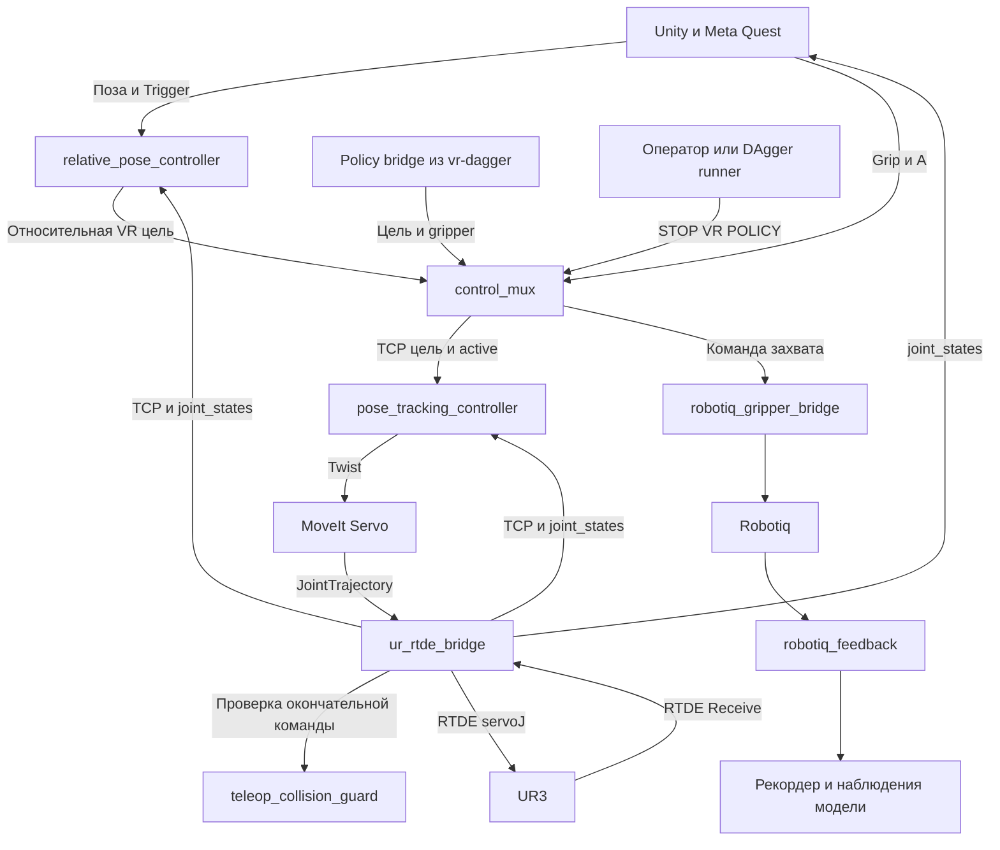

# Подробное описание проекта UR3 VR Teleoperation

Дата описания: 23 ноября 2026 года.

Исходный проект: `/home/isr-lab-4/Kosenkov/ur3-vr-teleoperation`.
Версия исходников: `8df7ea1566366b28440a9fc5934b5338aae98819`, коммит от 22 ноября 2026 года. На момент анализа рабочее дерево Git не содержало отслеживаемых изменений.

Проект обеспечивает управление реальным шестисуставным манипулятором Universal Robots UR3 и захватом Robotiq из VR-приложения Unity для Meta Quest. Он объединяет ввод оператора, измерения робота, выбор источника команд, локальное управление положением TCP и проверку допустимости движения. Через согласованные ROS-интерфейсы проект также подключается к внешнему контуру записи демонстраций, обучения политики и DAgger.

Описание основано на локальных исходниках, launch-конфигурации, Docker-конфигурации и документации репозитория. Аппаратный запуск, сборка APK и повторное выполнение тестов в рамках этого анализа не проводились. Возможности соседнего `vr-dagger` приведены по интеграционному контракту и руководству текущего проекта; его реализация отдельно не аудировалась.

## Содержание

1. Назначение и границы проекта
2. Технологии и требования
3. Структура файлов
4. Архитектура управления
5. Управление из Unity и Quest
6. Системы координат и относительная цель
7. Выбор источника STOP VR POLICY
8. Контроллер позы и RTDE
9. Проверка столкновений
10. Управление захватом и измеренная обратная связь
11. ROS-топики и сервисы
12. Синхронизация времени
13. Конфигурация и развёртывание
14. Запись демонстраций и обучение
15. Подключение политики и DAgger
16. Диагностика и проверки
17. Ограничения и особенности сопровождения
18. Источники и происхождение компонентов

## 1. Назначение и границы проекта

Основная задача — дать оператору возможность перемещать TCP робота движениями правого VR-контроллера и управлять степенью закрытия захвата. Относительное управление с clutch позволяет отпускать Trigger, менять положение руки и продолжать работу с новой привязкой без возврата робота к старой цели.

Практические сценарии:

- ручная телеоперация и демонстрация манипуляционных задач;
- наблюдение за фактическим положением UR3 в Unity;
- предварительная проверка ввода и целей без отправки команд движения;
- передача измерений и команд внешнему рекордеру;
- выполнение целей обученной политики через штатный контур управления;
- подтверждённая передача управления между политикой и оператором для DAgger.

В репозитории поддерживается **единственный backend RTDE**. STOP, VR и POLICY — режимы выбора источника внутри него. Команды `up` и `rtde` запускают один и тот же launch. Старые backend `speedl` и `servo_sim` удалены; сохранённые исторические документы и вспомогательные скрипты не означают, что эти режимы доступны в текущем запуске.

Разделение ответственности между проектами:

| Область | ur3-vr-teleoperation | Соседний vr-dagger |
|---|---|---|
| VR-ввод и Unity-сцена | Да | Использует опубликованные события |
| RTDE и фактическое состояние UR3 | Да | Подписывается на измерения |
| Выбор источника управления | `control_mux` | Запрашивает переключения |
| Контроллер позы и MoveIt Servo | Да | Передаёт высокоуровневые цели |
| Команды и измерения Robotiq | Да | Записывает и использует их |
| Камеры wrist и external | Нет | Да |
| rosbag, конвертация LeRobot | Нет | Да |
| Обучение Diffusion Policy | Нет | Да |
| Policy bridge и DAgger runner | Публикуемые интерфейсы | Реализация и Unix-сокеты |

Название целевой папки `vr_dagge` не меняет предмет описания: здесь описан исходный проект `ur3-vr-teleoperation` и его связь с `vr-dagger`.

## 2. Технологии и требования

| Компонент | Версия или назначение |
|---|---|
| Робот | UR3, конфигурация запуска ориентирована на CB3 |
| Захват | Robotiq 2F, управление через URCap socket |
| VR | Meta Quest и правый XR-контроллер |
| Unity Editor | `6000.2.15f1` |
| Meta XR Core | `85.0.0` в `unity/Packages/manifest.json` |
| XR Interaction Toolkit | `3.2.2` |
| OpenXR | `1.16.1` |
| ROS | ROS 2 Humble |
| Контейнерная основа | `ros:humble-ros-base-jammy` |
| RTDE-библиотека | `ur_rtde==1.6.2` |
| Кинематика и локальное движение | MoveIt Servo, KDL, `ur_description` |
| Проверки геометрии | MoveIt/FCL в пакете `teleop_collision` |
| Unity ↔ ROS | ROS-TCP Connector и ROS-TCP Endpoint |
| Основные языки | C# в Unity, Python в `teleop_core`, C++17 в collision guard |
| Развёртывание backend | Linux, Docker Engine, Docker Compose v2 |

Для Quest требуется Android Build Support в Unity. Для вспомогательных скриптов и unit-тестов используется Python 3. .NET нужен для автономных C#-проверок. `uv`, LeRobot, обучение и GPU-окружение относятся к соседнему проекту.

ROS-TCP Endpoint закреплён в Dockerfile на revision `05a3b25a11d9639549ae128e471bd696430b91f7`. Git-зависимости Unity также содержат конкретные revisions. Базовый Docker-образ и apt-пакеты не закреплены по digest и полному набору версий, поэтому побайтовая воспроизводимость сборки не гарантируется.

Источники: `ros/Dockerfile`, `ros/requirements.txt`, `unity/Packages/manifest.json`, `unity/ProjectSettings/ProjectVersion.txt`.

## 3. Структура файлов

```text
ur3-vr-teleoperation/
├── README.md                    Краткое описание и вход в документацию
├── how_to_use.md                Рабочий цикл VR, запись, обучение, rollout
├── usefull.md                   Локальные заметки и примеры диагностики
├── AGENTS.md                    Правила работы с репозиторием
├── compose.yaml                Один сервис teleop
├── .env.example                Пример параметров установки
├── scripts/
│   ├── run.sh                  Обёртка Docker Compose и смена режима
│   ├── patch-meta-xr.py         Локальное исправление Meta SDK для Linux
│   └── rtde-servo-timing.py     Отдельный аппаратный эксперимент servoL
├── ros/
│   ├── Dockerfile
│   ├── requirements.txt
│   ├── scripts/entrypoint.sh    Перевод переменных окружения в launch-аргументы
│   └── ros2_ws/src/
│       ├── teleop_core/
│       │   ├── launch/rtde_real.launch.py
│       │   ├── config/         Servo, SRDF, лимиты, KDL, геометрия сцены
│       │   ├── setup.py        Регистрация исполняемых ROS-узлов
│       │   └── teleop_core/    Контроллеры, mux, RTDE, gripper, диагностика
│       └── teleop_collision/
│           ├── src/collision_guard.cpp
│           ├── src/clearance_policy.hpp
│           └── test/clearance_policy_test.cpp
├── unity/
│   ├── Assets/Scenes/WorkshopScene.unity
│   ├── Assets/Scripts/         Прикладные компоненты проекта
│   ├── Assets/RSL/             Меню, визуализация, библиотечная телеметрия
│   ├── Assets/RosMessages/     C#-представления ROS-сообщений
│   ├── Packages/
│   └── ProjectSettings/
├── tests/                      Python, ROS smoke и автономные C#-проверки
├── docs/                       Архитектура, RTDE, коллизии, история проверок
├── licenses/                   Лицензии включённых ресурсов
└── tmp/                        Локальная рабочая область, не документация проекта
```

В `unity/Assets` присутствуют библиотечные ресурсы и примеры для других роботов, сенсоров и способов визуализации. Наличие такого asset не означает, что он участвует в текущем управлении UR3. При анализе рабочего контура важнее launch-файл и активные компоненты `WorkshopScene`.

`usefull.md` содержит фрагменты терминальной работы, включая неуниверсальные команды. Основными инструкциями для запуска являются `README.md`, `how_to_use.md` и актуальные документы `docs/`.

## 4. Архитектура управления



Основные уровни системы:

1. **Unity** снимает пользовательский ввод и отображает модель. Роботная привязка руки вычисляется на стороне ROS.
2. **Relative controller** преобразует движения руки относительно момента нажатия Trigger в TCP-цель.
3. **Mux** выбирает один источник позы и захвата, отслеживает эпоху управления и устаревание policy-команд.
4. **Pose controller** вычисляет линейную и угловую скорость по ошибке TCP-позы.
5. **MoveIt Servo** преобразует Twist в ограниченные суставные команды с учётом кинематики, сингулярностей и сцены.
6. **RTDE bridge** строит непрерывную суставную позиционную команду, проверяет её и отправляет `servoJ`.
7. **Обратная связь** приходит от RTDE Receive и отдельного read-only опроса Robotiq.

Контур использует несколько частот. Unity и относительный контроллер ориентированы на 30 Гц; mux работает на 125 Гц и публикует статус на 30 Гц; контроллер позы, Servo и RTDE ориентированы на 125 Гц; проверка близости в Servo — 50 Гц; обратная связь Robotiq — примерно 10 Гц. Это заданные частоты, а не подтверждённые измерениями характеристики конкретного запуска.

`rtde_real.launch.py` также запускает `robot_state_publisher`, ROS-TCP Endpoint, collision guard и `servo_twist_enable`. Последний вызывает сервис запуска Servo; он не является отдельным источником целей робота.

## 5. Управление из Unity и Quest

Рабочая сцена: `unity/Assets/Scenes/WorkshopScene.unity`.

| Действие | Компонент | Поведение |
|---|---|---|
| Движение правой руки | `ControllerPosePublisher` | Публикует позу относительно `robotBase`, с преобразованием Unity → ROS FLU |
| Trigger | `ControllerPosePublisher` | Разрешает clutch при корректном tracking и после наблюдаемого отпускания |
| Grip | `ControllerGripperPublisher` | Задаёт нормированное закрытие захвата |
| A | `ControllerGripperPublisher` | Переключает удержание текущей команды захвата и следование Grip |
| B | `DatasetRecordingButton` | Отправляет событие переключения записи внешнему рекордеру |
| Calibration | `WorkshopViewCalibration` | Выравнивает VR-вид и временно блокирует ввод позы и захвата |
| Измеренные суставы | `Ur3ArticulationJointStateSubscriber` | Отображает реальное состояние UR3 по `/joint_states` |

### Trigger и повторное разрешение

Контроллер начинает работу после корректного отпускания Trigger. После потери tracking состояние разрешения сбрасывается. Восстановление tracking при уже нажатом Trigger не должно немедленно возобновлять движение: требуется отпускание и новое нажатие.

При отпускании Trigger оператор может перенести руку в удобное положение. Следующее нажатие создаёт новую привязку к текущему фактическому TCP. Эта операция не завершает запись эпизода.

### Захват

Аналоговый Grip преобразуется в диапазон 0…1 и квантуется через 0…255. Команда публикуется при изменении, с ограничением частоты до заданного `gripperPublishHz` — по умолчанию 10 Гц. A фиксирует текущее значение; в таком режиме отпускание Grip сохраняет заданное закрытие. Потеря tracking сама по себе не генерирует команду открытия.

Локальная анимация пальцев управляется состоянием команды Unity. Её следует отличать от измеренного положения физического Robotiq, которое публикует ROS-узел feedback.

### Кнопка записи

Событие B содержит `schema=1`, идентификатор сессии, возрастающий `sequence` и `stamp_ns` в UTC-наносекундах. Обработка фронта кнопки предотвращает повторное событие при удержании и после восстановления tracking с нажатой B. Компонент проверяет доступность ROS-соединения. Статус внешнего рекордера возвращается по `/dataset/recording_status` и выводится в Unity log.

### Калибровка вида

`WorkshopViewCalibration` меняет yaw и размещение XR origin относительно визуального робота, сохраняя высоту головы. Это ручное выравнивание вида для сеанса, а не измеренная калибровка базы реального робота или точный spatial anchor. Во время процедуры ввод позы и захвата блокируется; B остаётся самостоятельным компонентом.

### Дополнительные компоненты

В рабочей сцене отключены старые диагностические publishers виртуальных суставов и `tool0`, локальный `ClutchedTeleopTarget`, `FramePoseDebug` и прежняя подписка `/team_1/tcp_actual`. `TcpTargetPublisher` также выключен. Их исходники сохранены для явной отладки.

RSL-компоненты `HandPub`, `HeadsetPublisher`, `JoystickManager` и `PosePublisher` имеют флаг `publishRosTelemetry`, по умолчанию false. Дополнительная телеметрия включается до Play; меню и визуальные возможности RSL продолжают использоваться независимо от этого флага.

Источники: `unity/Assets/Scripts/`, `docs/architecture.md`, `tests/test_unity_scene_contract.py`.

## 6. Системы координат и относительная цель

Соглашения интерфейса:

- линейные величины в ROS — метры;
- углы суставов и угловые ограничения — радианы;
- кватернионы ROS — `(x, y, z, w)`;
- TCP-цели и фактический TCP — frame `base`;
- входная поза руки — frame `vr_robot_base`;
- планирование Servo и пол сцены — `base_link`;
- конечное звено настроенной цепи — `teleop_tcp`.

Unity преобразует локальную позу контроллера в ROS FLU через ROSGeometry. Затем `relative_pose_controller` применяет дополнительное согласование осей, по умолчанию yaw 180°. `base` и `base_link` официальной модели UR различаются поворотом; поэтому названия frame и преобразования нельзя произвольно взаимозаменять.

При включении clutch запоминаются поза руки `H₀` и текущая TCP-поза `T₀`. Для позиции используется:

```text
p_target = p_TCP₀ + scale · R_mapping · (p_hand − p_hand₀)
```

Ориентация формируется из относительного вращения руки, перенесённого через `R_mapping` в роботную систему и применённого к исходной ориентации TCP. В `pose_control.py` это реализовано операциями над нормированными кватернионами.

Привязка к `T₀` остаётся фиксированной, пока удерживается Trigger. Если каждый цикл переносить её на текущий TCP, цель начнёт смещаться вместе с роботом; текущая реализация этого избегает. Превышение допустимого смещения или вращения вызывает fault и требует нового отпускания.

### Модель TCP

Launch создаёт фиксированное звено `teleop_tcp` относительно `tool0` по `tcp_xyz` и `tcp_rpy`. Одна модель используется Servo, TF и collision guard. Измерения RTDE должны соответствовать активному TCP, настроенному на контроллере UR.

Нулевое смещение — fallback launch. В `.env.example` задано `[0.0, 0.0, 0.150]`, то есть +150 мм вдоль tool Z. Это параметр конкретной установки, а не универсальная характеристика любого Robotiq.

При наличии `RTDE_KINEMATICS_PARAMS_FILE` подставляется файл кинематической калибровки. Без него используется номинальная модель `ur_description`. В стандартном Compose нет volume для такого файла: путь должен быть доступен внутри контейнера.

Источники: `pose_control.py`, `relative_pose_controller.py`, `ControllerPosePublisher.cs`, `rtde_real.launch.py`.

## 7. Выбор источника STOP VR POLICY

`control_mux_core.py` содержит независимую от ROS логику, `control_mux.py` — subscriptions, publishers, сервисы и проверку времени сообщений.

| Режим | Источник движения | Источник захвата | Условия |
|---|---|---|---|
| STOP | Цель не выдаётся | Новая команда не выдаётся | Старые цели очищены; автоматического открытия нет |
| VR | `/vr/target_pose` | Grip/A из Unity | Свежие pose, active, TCP и новое отпускание clutch |
| POLICY | `/policy/command` | Поле gripper policy-команды | Текущая epoch, один session-владелец, возрастающая sequence, свежий TCP |

При каждом выборе режима увеличивается `epoch`, очищаются цели и состояние владельца политики, создаётся короткое окно снятого разрешения около 0,1 с. Даже повторный выбор того же режима формирует новую эпоху.

Это предотвращает выполнение старой очереди после передачи управления. Политика должна знать текущую эпоху и публиковать команды от согласованной сессии. Дубликаты и переставленные sequence не принимаются. Запоздавшие policy-пакеты другой эпохи игнорируются и не останавливают новую сессию.

После начала policy-потока watchdog порядка 0,25 с переводит mux в STOP при прекращении свежих команд. Устаревшая обратная связь также прекращает исполнение. POLICY не возобновляет себя автоматически: после устранения причины требуется явный выбор режима и новый rollout.

В VR gripper-команды могут проходить при отпущенном Trigger: clutch управляет движением руки, а Grip/A — отдельным состоянием захвата. STOP не означает отправку `open`.

### Два уровня policy-ограничений

1. Исходная цель проверяется по workspace и допустимой удалённости от фактического TCP. По умолчанию пределы отбраковки — 0,20 м и 0,5 рад.
2. Принятая цель ограничивается относительно фактического TCP до 0,03 м и 0,17453 рад, то есть 10°.

Сначала проверяется исходное предсказание, затем выполняется ограничение. Поэтому аномально далёкая цель не превращается молча в допустимый маленький шаг. `/policy/target_status` сохраняет исходную и ограниченную цели, расстояние, угол и `clipped`.

Workspace в текущем ядре mux: x/y от −0,6 до +0,6 м, z от −0,01 до +1 м в `base`. В ROS-обёртке эти границы не объявлены отдельными параметрами; не следует ожидать, что произвольная новая переменная `.env` изменит их.

## 8. Контроллер позы и RTDE

### Контроллер ошибки позы

`pose_tracking_controller.py` сравнивает целевой и измеренный TCP. Линейная скорость пропорциональна ошибке положения. Угловая скорость пропорциональна rotation vector относительного вращения `q_target · inverse(q_actual)`.

Линейная и угловая нормы ограничиваются независимо. В POLICY используются минимумы между общими лимитами и специальными policy-лимитами, поэтому политика не может получить большее разрешение, чем общий контур. При отсутствии свежей цели, TCP или heartbeat публикуется нулевой Twist и снимается active.

### MoveIt Servo

Servo получает `TwistStamped` в физических единицах скорости и использует кинематическую цепь `manipulator`. Конфигурация включает:

- период 0,008 с при 125 Гц;
- кинематику KDL;
- ограничения скоростей и ускорений суставов;
- Butterworth smoothing;
- замедление и остановку около сингулярностей;
- проверку столкновений;
- публикацию `JointTrajectory` с positions и velocities.

Servo решает задачу локального следования. Планирование маршрута вокруг препятствий в этом контуре не реализовано.

### Зачем bridge интегрирует суставные скорости

Servo выдаёт короткую позиционную подсказку относительно измеренного Q и ограниченные скорости. Простая передача каждой такой позиции в отстающий позиционный servo может уменьшить фактическую скорость. Поэтому `JointServoSession` поддерживает непрерывную reference:

```text
q_reference_next = q_reference + anti_windup_scale · qd_servo · dt
```

Positions Servo сохраняются как проверка корректности входа; конечная команда строится интегрированием ограниченных velocities. Имена суставов проверяются и переупорядочиваются. Частичные, дублированные, нечисловые и выходящие за лимиты команды отклоняются.

### Anti-windup

При опережении измеренного Q интегрирование плавно замедляется. Один коэффициент применяется ко всему вектору суставных приращений, сохраняя его направление. Движение в сторону уменьшения накопленного опережения остаётся возможным.

Текущие пороги:

| Параметр | Значение | Назначение |
|---|---|---|
| `lead_soft_start` | 0,06 рад | Начало плавного уменьшения интегрирования |
| `lead_soft_limit` | 0,10 рад | Ограничение дальнейшего роста опережения |
| `max_joint_tracking_error` | 0,15 рад | Независимая жёсткая проверка рассогласования |

Требуется `0 < soft_start < soft_limit < tracking_limit`. При отказе команда сбрасывается, а диагностика указывает худший сустав, actual, command, delta и limit.

### Исполнение и отказы

RTDE Receive и Control создаются и используются в рабочем RTDE-потоке. ROS-callbacks передают ему актуальное состояние через защищённые структуры. В preview создаётся только Receive, управляющий RTDE script не загружается. Проверки входа и collision guard сохраняются, но reference не накапливается против неподвижного робота.

Bridge принимает одну короткую точку Servo, проверяет её горизонт, скорости, возраст, суставные границы и состояние разрешения. Для траекторий Servo со stamp=0 свежесть ограничивается временем получения, очередью глубины 1 и upstream heartbeat.

Остановочные статусы Servo `2`, `4`, `5` защёлкиваются. Для возврата после такого останова требуется физическое отпускание clutch и свежий статус Servo без остановки. Произвольное падение производного `/teleop/servo/active` не считается физическим отпусканием.

Пропуск более четырёх периодов управления при активной команде вызывает `MISSED_CONTROL_PERIOD_RELEASE_TO_REARM`. При 125 Гц это порог около 32 мс. Ошибка допустимости команды может быть восстановимой через release/rearm; отказ выполнения `servoJ` переводится в `EXECUTION_FAULT_RESTART_REQUIRED`. При восстановимых отказах Receive продолжает публиковать свежие измерения.

Источники: `joint_control.py`, `pose_tracking_controller.py`, `ur_rtde_bridge.py`, `config/ur3_rtde_servo.yaml`.

## 9. Проверка столкновений

В системе используются два независимых слоя.

**MoveIt Servo** проверяет текущую сцену на 50 Гц и замедляет движение при приближении. Пороги близости: 1 см для самостолкновений и 2 см для объектов мира.

**Collision guard** получает окончательную суставную reference bridge перед каждым `servoJ`, включая удержание. Он проверяет путь от свежего фактического Q до команды, суставные границы, опережение и геометрию. Максимальный шаг дискретизации по суставам — 0,02 рад.

### Представление геометрии

- официальные collision-меши звеньев UR3;
- SRDF с исключениями конструктивно допустимых пар;
- сфера радиусом 0,01 м вокруг `teleop_tcp`;
- пол в `base_link` размером 4 × 4 × 2 м, верхняя поверхность на z = −0,01 м;
- исключение контакта с полом только для неподвижных монтажных звеньев `base_link` и `base_link_inertia`.

Отступы guard: 5 мм до сцены и 3 мм для самостолкновений. Если положительный зазор уже меньше отступа, допустимы удержание и проверенный выход с улучшением зазора без ухудшения другого недостаточного зазора. Контакт и проникновение блокируются.

Сервис `/teleop/check_state_validity` использует `moveit_msgs/srv/GetStateValidity`. При недоступности сервиса, отказе или превышении timeout 20 мс bridge не отправляет команду, сбрасывает reference и требует повторного разрешения.

Существенные границы модели: TCP-сфера не описывает корпус и пальцы Robotiq; удерживаемый объект не добавляется автоматически; камеры не строят collision-сцену. Неописанные препятствия не получают автоматической защиты. Проверка пути дискретная и не является доказательством непрерывной бесконтактной траектории. Эти ограничения непосредственно влияют на допустимые рабочие сцены.

Источник: `docs/collisions.md`, `config/collision_scene.yaml`, `teleop_collision/src/`.

## 10. Управление захватом и измеренная обратная связь

Командный и измерительный каналы разделены.

```text
Unity Grip/A → /team_1/gripper_command → control_mux
             → /teleop/gripper_command → robotiq_gripper_bridge
             → SET-команды на URCap socket

Robotiq → GET POS/PRE/OBJ/STA → robotiq_feedback
        → /teleop/gripper_state → запись и наблюдение политики
```

`robotiq_gripper_bridge` принимает нормированное значение, совместимые бинарные команды и байтовые позиции. Он исполняет последнее актуальное значение, а не всю очередь накопившихся переходов. Минимальный интервал команд в реализации — 0,20 с. По умолчанию используются порт 63352, скорость 180 и сила 20. При первой отправке выполняются необходимые команды активации.

`robotiq_feedback` работает через отдельное соединение и отправляет только GET. Он может быть включён при выключенном разрешении движения захвата. Успешные данные публикуются по новой выборке; ошибка чтения формирует `valid=false` вместо подстановки старого положения.

| Поле JSON | Значение |
|---|---|
| `schema` | Версия структуры, сейчас 1 |
| `valid` | Признак пригодности; успешное чтение требует `STA=3` |
| `stamp_ns` | Время измерения POS |
| `position`, `position_norm` | Измеренное положение и его нормировка |
| `requested_position`, `requested_norm` | Запрошенная позиция PRE |
| `object_status` | OBJ: движение, контакт или достижение цели |
| `activation_status` | STA, состояние активации |
| `moving`, `contact_detected`, `at_destination` | Производные признаки |
| `sample_span_s` | Длительность последовательного опроса регистров |

При захвате предмет может остановить пальцы до достижения заданной позиции. Поэтому измеренное закрытие для observation и целевое закрытие для action имеют разный смысл. OBJ=1/2 означает контакт; OBJ=3 — достижение заданного положения. В интеграционном руководстве для модели требуется возраст измерения не более 0,25 с.

Источники: `gripper_control.py`, `robotiq_gripper_bridge.py`, `robotiq_feedback.py`, `how_to_use.md`.

## 11. ROS-топики и сервисы

Типы ниже относятся к поддерживаемому контуру. Форматы строковых JSON-сообщений — часть интеграционного контракта.

### Ввод и движение

| Топик | Тип | Издатель → потребитель |
|---|---|---|
| `/vr/right_hand/pose` | `geometry_msgs/PoseStamped` | Unity → relative controller |
| `/vr/right_hand/active` | `std_msgs/Bool` | Unity → relative controller, mux, bridge |
| `/vr/target_pose` | `geometry_msgs/PoseStamped` | Relative controller → mux |
| `/vr/target_active` | `std_msgs/Bool` | Relative controller → mux |
| `/teleop/target_pose` | `geometry_msgs/PoseStamped` | Mux → pose controller, recorder |
| `/teleop/active` | `std_msgs/Bool` | Mux → pose controller и наблюдатели |
| `/teleop/servo/twist` | `geometry_msgs/TwistStamped` | Pose controller → Servo |
| `/teleop/servo/active` | `std_msgs/Bool` | Pose controller → bridge |
| `/teleop/servo/joint_trajectory` | `trajectory_msgs/JointTrajectory` | Servo → bridge |
| `/joint_states` | `sensor_msgs/JointState` | Bridge → Servo, TF, guard, Unity |
| `/teleop/tcp_actual` | `geometry_msgs/PoseStamped` | Bridge → контроллеры, mux, recorder |
| `/tf`, `/tf_static` | `tf2_msgs/TFMessage` | TF модели → наблюдатели |

### Режимы, захват и запись

| Топик | Тип и содержание |
|---|---|
| `/teleop/control_mode` | `std_msgs/String`: STOP, VR или POLICY |
| `/teleop/control_status` | `std_msgs/String`, JSON: schema, mode, control_source, epoch, reason, owner, policy_limits, transition_request_id, stamp_ns |
| `/team_1/gripper_command` | `std_msgs/String`, исходная команда Unity |
| `/teleop/gripper_command` | `std_msgs/String`, выбранная mux команда |
| `/teleop/gripper_state` | `std_msgs/String`, измерительная JSON-структура Robotiq |
| `/vr/dataset/toggle` | `std_msgs/String`, событие B с session и sequence |
| `/dataset/recording_status` | `std_msgs/String`, ответ внешнего рекордера |
| `/teleop/clock_ping`, `/vr/clock_pong` | `std_msgs/String`, обмен для оценки времени |

### Политика и DAgger

| Интерфейс | Назначение |
|---|---|
| `/policy/command` | String JSON с `epoch`, `session`, `sequence`, `stamp_ns`, `position`, `quaternion`, `gripper` |
| `/policy/stop` | String JSON, остановка от владельца текущей policy-эпохи |
| `/policy/target_status` | String JSON, результат проверки и ограничения цели |
| `/teleop/control/request` | String JSON: `request_id`, `mode`, `expected_epoch`, `stamp_ns` |
| `/teleop/control/request_status` | String JSON: подтверждение запроса и результирующая эпоха |
| `/dagger/status` | Статус из внешнего DAgger bridge, включая экспертные метки |

Режим и control status используют transient-local durability глубины 1. Для высокочастотных каналов команд обычно выбрана малая глубина очереди, чтобы не воспроизводить backlog устаревших движений.

### Сервисы

| Сервис | Тип | Назначение |
|---|---|---|
| `/teleop/control/stop` | `std_srvs/Trigger` | Выбор STOP |
| `/teleop/control/vr` | `std_srvs/Trigger` | Выбор VR |
| `/teleop/control/policy` | `std_srvs/Trigger` | Выбор POLICY |
| `/teleop/check_state_validity` | `moveit_msgs/GetStateValidity` | Проверка конечной суставной команды и пути |
| `/servo_node/start_servo` | Сервис MoveIt Servo | Запуск обработки Servo через `servo_twist_enable` |

Стабильный контракт подробно зафиксирован в `docs/architecture.md`. Камеры, `/dataset/gripper_target` и хранение bag относятся к `vr-dagger`. ROS-TCP Endpoint может отображать часть связей как UNKNOWN; одного такого вывода недостаточно для вывода о неработающем потоке.

## 12. Синхронизация времени

Timestamp от Quest и ROS-хоста нельзя сравнивать напрямую без оценки смещения часов. `ClockSync` использует четыре времени отправки и получения, аналогично обмену NTP:

```text
t0: ROS отправил ping
t1: Unity получил ping
t2: Unity отправил pong
t3: ROS получил pong

offset(client − ROS) = ((t1 − t0) + (t2 − t3)) / 2
```

Ping отправляется раз в 0,5 с. Требуются минимум три выборки; обмен с RTT больше 0,1 с отклоняется. Хранятся до 20 выборок с TTL 5 с, выбирается оценка с минимальным RTT.

Смена Unity session и существенный скачок часов сбрасывают оценку и привязку руки. До получения свежей синхронизации рука не разрешается как достоверный источник. Проверяются как timestamp источника, так и время с момента получения сообщения; повторная доставка старого pose не должна освежать команду.

Для входной руки существуют отдельные пределы возраста источника и возраста последнего принятого сообщения. В текущем узле source timeout составляет 1 с, а heartbeat/receipt timeout — 0,25 с. Возраст TCP проверяется относительно локального ROS-времени, поскольку измерения публикуются на том же хосте.

Источники: `clock_sync.py`, `relative_pose_controller.py`, `ControllerPosePublisher.cs`.

## 13. Конфигурация и развёртывание

### Устройство контейнера

Compose описывает один сервис `teleop` с образом `ur3-vr-teleoperation:humble`, `network_mode: host` и командой `rtde_real`. Dockerfile устанавливает ROS-зависимости, RTDE и Endpoint, копирует оба ROS-пакета и собирает их через colcon.

В стандартном Compose исходники backend не смонтированы как рабочий volume. Несмотря на `--symlink-install` внутри образа, изменение файлов на хосте не обновляет установленный код контейнера. После изменения backend требуется пересборка образа и пересоздание сервиса.

Цепочка параметров:

```text
Окружение shell и .env
    → подстановка Compose
    → environment контейнера
    → ros/scripts/entrypoint.sh
    → launch arguments
    → параметры ROS-узлов
```

Переменная должна пройти все необходимые звенья. Простое добавление имени в `.env` не создаёт новый параметр узла. `run.sh` намеренно не выполняет `.env` через `source`; Compose обрабатывает его как конфигурацию.

### Основные параметры

Здесь fallback означает значения Compose/launch при отсутствии переопределения. Это важно: пример `.env.example` уже задаёт другую рабочую конфигурацию.

| Параметр | Fallback | Значение в `.env.example`, если отличается |
|---|---|---|
| `RTDE_ENABLE_MOTION` | false | **true** |
| `RTDE_ENABLE_GRIPPER` | false | **true** |
| `RTDE_ENABLE_GRIPPER_FEEDBACK` | true | true |
| `TELEOP_CONTROL_MODE` | STOP | STOP |
| `RTDE_FREQUENCY` | 125 Гц | 125 Гц |
| `ROS_DOMAIN_ID` | 11 | 11 |
| `ROS_LOCALHOST_ONLY` | 1 | 1 |
| `ROS_TCP_PORT` | 10000 | 10000 |
| `RTDE_POSITION_SCALE` | 1 | 1 |
| `RTDE_MAPPING_YAW_DEG` | 180° | 180° |
| `RTDE_MAX_DISPLACEMENT` | 0,25 м | 0,5 м |
| `RTDE_MAX_ROTATION` | 1 рад | около π/2 рад |
| `RTDE_MAX_LINEAR_SPEED` | 0,020 м/с | 0,14 м/с |
| `RTDE_MAX_ANGULAR_SPEED` | 0,12 рад/с | 1,2 рад/с |
| `RTDE_POSITION_GAIN` | 2,0 | 2,5 |
| `RTDE_ROTATION_GAIN` | 2,0 | 2,0 |
| `RTDE_COMMAND_TIMEOUT` | 0,25 с | 0,25 с |
| `RTDE_FEEDBACK_TIMEOUT` | 0,25 с | 0,25 с |
| `RTDE_TRAJECTORY_TIMEOUT` | 0,1 с | Не переопределён |
| `RTDE_MAX_JOINT_TRACKING_ERROR` | 0,15 рад | Не переопределён |
| `RTDE_LOOKAHEAD_TIME` | 0,1 с | 0,1 с |
| `RTDE_GAIN` | 300 | 300 |
| `RTDE_TCP_XYZ` | `[0, 0, 0]` м | `[0, 0, 0.150]` м |
| `RTDE_FLOOR_Z` | −0,01 м | −0,01 м |
| `POLICY_MAX_LINEAR_SPEED` | 0,020 м/с | 0,020 м/с |
| `POLICY_MAX_ANGULAR_SPEED` | 0,12 рад/с | 0,12 рад/с |
| `POLICY_TARGET_DISTANCE` | 0,03 м | 0,03 м |
| `POLICY_TARGET_ROTATION` | 10° | 10° |
| `POLICY_MAX_DISTANCE` | 0,20 м | 0,20 м |
| `POLICY_MAX_ROTATION` | 0,5 рад | 0,5 рад |

`ROBOT_IP` должен соответствовать контроллеру конкретной установки. ROS domain управляет discovery ROS, а не выбором робота. `ROS_LOCALHOST_ONLY=1` совместим с подключением Quest через ROS-TCP Endpoint: это отдельное TCP-соединение на порт 10000.

`RTDE_POSE_CHECK_MODE=local` присутствует в `.env.example`, но не передаётся текущими Compose и entrypoint в единственный launch. Поэтому его нельзя считать действующим переключателем текущего backend.

### Предварительный запуск без исполнения

Из корня исходного проекта, после настройки `.env`:

```bash
./scripts/run.sh build
TELEOP_CONTROL_MODE=STOP RTDE_ENABLE_MOTION=false RTDE_ENABLE_GRIPPER=false \
  RTDE_ENABLE_GRIPPER_FEEDBACK=true ./scripts/run.sh rtde
./scripts/run.sh logs
```

Preview всё равно подключается к реальному контроллеру для измерений. Чтобы проверить прохождение VR-целей, при сохранённых false-разрешениях можно явно выбрать VR и проверить tracking. Начальный STOP сам по себе не пропускает цели на исполнение.

После реального разрешения `RTDE_ENABLE_MOTION=true` создаётся ControlInterface и загружается управляющий script. Это отличается от выбора VR/POLICY: разрешение движения и источник команд — два отдельных уровня.

### Команды обёртки

| Команда | Результат |
|---|---|
| `./scripts/run.sh build` | Сборка backend-образа |
| `./scripts/run.sh rtde` или `up` | Запуск сервиса без автоматической сборки |
| `./scripts/run.sh mode STOP` | Снятие команд через mux |
| `./scripts/run.sh mode VR` | Выбор VR, затем требуется отпускание Trigger |
| `./scripts/run.sh mode POLICY` | Выбор новой policy-эпохи |
| `./scripts/run.sh logs` | Просмотр логов; Ctrl+C завершает просмотр |
| `./scripts/run.sh ps` | Статус сервиса |
| `./scripts/run.sh topics` | Список ROS-топиков |
| `./scripts/run.sh shell` | Shell контейнера |
| `./scripts/run.sh down` | Остановка и удаление сервиса Compose |
| `./scripts/run.sh workflow help` | Вызов workflow соседнего `vr-dagger` |

`VR_DAGGER_ROOT` позволяет переопределить путь внешнего workflow. Без него скрипт ожидает `../vr-dagger` относительно исходного проекта.

### Unity

Открыть `unity/` в нужной версии Editor и загрузить WorkshopScene. В ROS Settings выбрать ROS 2 и адрес backend: `127.0.0.1` для Editor на том же ПК или доступный адрес компьютера для Quest. Порт — 10000. По инструкции проекта `Listen For TF Messages` оставляется выключенным: модель руки получает `/joint_states`.

После изменения C# или сцены требуется новый APK на Quest. Для известной Linux-ошибки Meta XR SDK используется `python3 scripts/patch-meta-xr.py`; после пересоздания `unity/Library` исправление может потребоваться повторно.

## 14. Запись демонстраций и обучение

Этот раздел описывает интеграционный рабочий процесс из `how_to_use.md`. Реализация камер, рекордера, конвертера и обучения находится в соседнем `vr-dagger`.

### Жизненный цикл демонстрации

1. Запускается backend UR3, выбирается VR, оператор проверяет привязку руки.
2. Внешний capture-контур запускает камеры wrist и external.
3. Проверяется свежесть измерений и известная целевая команда захвата.
4. B начинает запись следующего свободного эпизода.
5. Оператор выполняет задачу, включая паузы и отпускания clutch.
6. Повторное B завершает и финализирует bag.
7. Запись проверяется на готовность к конвертации.
8. Эпизоды конвертируются в LeRobot и объединяются в отдельный набор.
9. Запускаются обучение и последующая диагностика выбранного checkpoint.

Одинаковая задача задаётся одинаковой строкой `task`. Начало обучающего эпизода определяется первым полным пригодным набором данных после начала записи, а не первым нажатием Trigger. Ручной recorder и recorder по B не должны писать одновременно.

### Состав наблюдения и действия

Для описанного в руководстве режима с measured gripper:

| Поле | Размерность | Смысл |
|---|---|---|
| `observation.state` | 16 | 6 joint angles + 3 actual TCP position + 6 orientation + 1 measured gripper |
| RGB wrist | Изображение | Камера на кисти |
| RGB external | Изображение | Внешняя камера |
| `action` | 10 | 3 actual TCP position следующего кадра + 6 orientation следующего кадра + 1 текущая target gripper command |

Ориентация из 6 чисел — первые две колонки матрицы вращения. Это отдельное представление, которое policy bridge переводит в ROS-кватернион.

TCP-часть action использует измеренную позу следующего кадра. При 30 FPS сдвиг составляет примерно 33,3 мс. В конце эпизода удерживается последняя измеренная поза. Наблюдение и команда захвата не сдвигаются. Следовательно, нельзя просто считать весь action следующим observation.state или обучать модель на визуальной позиции Unity.

Состояния POS/PRE/OBJ/STA дополнительно сохраняются в `gripper_feedback.jsonl`. Отсутствующее измерение не заменяется командой или нулём. RTDE preview не принимается как демонстрация выполненного движения.

### Артефакты и обучение

В руководстве описаны `episode.json`, `bag/metadata.yaml`, SQLite `.db3`, затем отдельные LeRobot-эпизоды с видео и пакетный отчёт конвертации. При повторной конвертации готовые совместимые результаты пропускаются; несовместимые выходные каталоги не перезаписываются. Объединённый датасет создаётся в новой папке и сам не пополняется.

Документы используют разные пути обычных bags: `how_to_use.md` показывает `data/bags`, а актуальный раздел workflow в `docs/architecture.md` упоминает `bags_clean_table`. Для конкретного сценария фактический путь следует брать из конфигурации и лога текущего `vr-dagger`; это не единый путь, определяемый teleop-backend.

Описанный training script использует Diffusion Policy, batch 16, два наблюдения, горизонт 16 и исполнение блоками по 8 действий. Параметры числа шагов, eval split и checkpoint directory задаются в соседнем проекте. Примеры в руководстве с 49 эпизодами и различными train/validation-разбиениями относятся к конкретным наборам и не являются общим требованием системы.

Валидация отделяется целыми эпизодами. Для набора с явно заданными validation demos скрипт читает holdout из manifest; переопределять eval split так, чтобы изменить этот выбор, не следует. Содержимое datasets и качество checkpoint в этом анализе не проверялись.

Две raw RGB-камеры 640 × 480 при 30 FPS по оценке руководства дают около 50–55 МБ/с в bag. Это оценка объёма потока, а не измерение свободного места. Эпизоды с аварией, stale data или незавершённой финализацией требуют отдельной проверки перед обучением.

## 15. Подключение политики и DAgger

### Policy bridge

LeRobot и модель работают на хосте. ROS bridge находится в capture-контуре и соединяется с хостовым клиентом через Unix socket `data/ipc/ur3_policy.sock`. Благодаря этому окружению модели не требуется установка `rclpy`.

Последовательность допуска к выполнению:

1. Предварительная проверка модели на реальных наблюдениях без отправки действий.
2. Проверка исходных целей, ограниченных целей, `would_STOP` и gripper.
3. Явное включение аппаратного RTDE backend и исполняющего policy bridge.
4. Явный выбор POLICY.
5. Запуск rollout с `--execute`.

Диагностика и обычный rollout без флага исполнения предназначены для preview. Отсутствие `would_STOP` означает прохождение перечисленных проверок цели, а не успешное выполнение манипуляционной задачи.

Синхронный rollout отправляет блок из 8 действий с целевой частотой 30 Гц. Расчёт следующего блока может уменьшать фактическую cadence; её нужно оценивать по логу. По руководству первые 8 действий адаптера используются для прогрева без исполнения. После смены эпохи старая очередь не используется.

### DAgger

DAgger позволяет политике действовать, а человеку — перехватывать управление и формировать исправления. В этом проекте реализован условный интерфейс передачи управления: запрос содержит `expected_epoch`, и mux выполняет проверку эпохи и переключение в одном callback. Запоздавший запрос не может изменить новую эпоху.

Внешний `ros_dagger_bridge.py` использует отдельный socket `data/ipc/ur3_dagger.sock` и публикует session, phase, intervention_id, epoch и экспертные признаки. `transition_request_id` в control status связывает эпоху с подтверждённой передачей.

Сам по себе режим VR не делает данные экспертными. В актуальном контракте schema=2 различаются:

- `expert_motion` — согласованный подтверждённый ввод человека с движением;
- `expert_pause` — подтверждённая пауза человека с новым свежим отпусканием clutch, inactive mux/Servo и подходящим RTDE-статусом;
- `expert` — объединение этих состояний.

Во время подтверждённой паузы могут сохраняться TCP и целевые команды захвата, включая открытие. Пропавший active-флаг не считается явным отпусканием. POLICY, STOP, fault, stale data и рассогласованные статусы разрывают экспертное окно. Метка `actual_next` не должна перескакивать через такие разрывы.

Mixed DAgger bags отделяются от обычных демонстраций, имеют `collection_mode=dagger` и отдельные правила выбора кадров. Отсутствие экспертных меток не позволяет объявить POLICY/UNKNOWN экспертной демонстрацией. Для воспроизведения прежнего motion-only отбора предусмотрен `pause-policy=exclude`; старые exports автоматически не перезаписываются.

Источник: `docs/architecture.md`, разделы DAgger и unified workflow; команды запуска — в соседнем `vr-dagger/README.dagger.md`.

## 16. Диагностика и проверки

### Основные статусы

| Канал | Что показывает |
|---|---|
| `/teleop/control_status` | Источник, epoch, owner, причина STOP и лимиты политики |
| `/teleop/pose_status` | Привязка руки, tracking, stale input, release-to-rearm |
| `/teleop/tracking_status` | Состояние следования TCP-цели |
| `/teleop/servo/status` | Числовой статус MoveIt Servo |
| `/teleop/rtde_status` | Подключение, preview, tracking, отказы исполнения |
| `/teleop/clock_status` | Готовность синхронизации, offset и RTT |
| `/teleop/collision_status` | Результат последней проверки command path |
| `/teleop/rtde_diagnostics` | Подробные строки цикла при включённой диагностике |

Collision status отражает последнюю проверку команды. До первого запроса guard может сообщать ожидание, хотя feedback уже поступает. Это следует отличать от непрерывного контроля idle-положения.

Расширенная RTDE-диагностика выключена по умолчанию (`publish_diagnostics=false`). Она включает actual Q, reference, velocities Servo, anti-windup scale, признак фактической отправки команды, статусы и длительности этапов. Время command step включает ожидание collision guard, поэтому не равно одному времени `servoJ`.

Примеры чтения состояния в уже запущенном контейнере:

```bash
./scripts/run.sh topics
./scripts/run.sh shell
source /opt/ros/humble/setup.bash
source /ws/install/setup.bash
ros2 topic echo /teleop/control_status --once
ros2 topic echo /teleop/tcp_actual --once
ros2 topic echo /teleop/gripper_state --once
ros2 topic echo /teleop/collision_status --qos-durability transient_local --once
```

### Проверки в репозитории

| Группа | Проверяемое поведение |
|---|---|
| `test_pose_control.py` | Привязка, отсутствие начального скачка, mapping, ограничения, rearm |
| `test_joint_control.py` | Порядок суставов, интегратор, anti-windup, tracking guard, collision veto |
| `test_control_mux.py` | Единственный источник, epoch, owner, timeout, clipping и gripper в VR |
| `test_clock_sync.py` | Offset, выбор RTT, TTL, смена session и скачки часов |
| `test_gripper_control.py` | Парсинг, нормировка и выбор последней команды |
| `test_robotiq_feedback.py` | GET-only, различие POS/PRE, ограниченный timeout |
| `test_entrypoint.py` | Аргументы запуска и отказ удалённых backend |
| `test_unity_scene_contract.py` | GUID/fileID и соединение pose/gripper/B в сцене |
| `test_patch_meta_xr.py` | Узкое и повторяемое исправление известной версии SDK |
| `test_rtde_diagnostics.py` | JSON, preview, отправленные команды и разрывы |
| `tests/gripper_command_state` | C# latch и фронты кнопок без полного Unity |
| `teleop_collision/test` | Политика допустимых зазоров |
| `*_ros_smoke.py` | Поведение узлов с ROS и поддельными аппаратными интерфейсами |

Стандартная offline-команда Python:

```bash
PYTHONDONTWRITEBYTECODE=1 \
PYTHONPATH=ros/ros2_ws/src/teleop_core \
python3 -m unittest discover -s tests -p 'test_*.py'
```

Feedback unit-тесты используют localhost sockets. C#-проверки запускаются через `dotnet run --project tests/gripper_command_state`. ROS smoke требуют ROS-зависимостей и изоляции от аппаратного домена; часть policy-проверок зависит от исходников соседнего `vr-dagger`.

### Исторически зафиксированный сбой

В `docs/rtde-cleanup.md` описан ранее воспроизведённый отказ расширенного `tests/rtde_ros_smoke.py`: `test_servo_halt_discards_reference_and_requires_physical_release` ожидает `q_cmd=null` во всех строках `SERVO_HALT_RELEASE_TO_REARM`, но переходный цикл нарушает это диагностическое условие. Документ сообщает 8 успешных тестов из 9 и отдельно отмечает, что отсутствие возобновления команд при удержании clutch проверку прошло.

Это запись о конкретной исторической проверке, а не результат нового запуска. Несогласованность диагностики и оставшаяся часть сценария требуют отдельной проверки; считать весь расширенный smoke-набор успешно пройденным на основании документа нельзя.

## 17. Ограничения и особенности сопровождения

### Что существенно для применения

- Текущий поддерживаемый запуск работает с реальным RTDE feedback. Preview отключает отправку движения, но не создаёт виртуальный робот вместо контроллера.
- 125 Гц — целевой период управления UR3 CB3; Linux, Python, ROS и синхронный service call не дают сами по себе гарантии жёсткого реального времени.
- Servo и guard ограничивают движение в заданной модели. Они не распознают произвольные предметы, пальцы захвата или удерживаемый объект без соответствующей геометрии.
- Ручная калибровка Unity выравнивает вид; корректность осей и активного TCP проверяется отдельно.
- Ограничения policy работают поверх штатного контура, а не заменяют Servo, watchdog и collision guard.
- Модель обучается на измеренном состоянии, поэтому важно сохранять различие фактической позы, цели и отправленной команды.
- После fault восстановление зависит от его класса: release/rearm для восстановимых блокировок и перезапуск для execution fault.

### Что важно при изменениях

| Изменение | Связанные места |
|---|---|
| Новый параметр backend | Compose → entrypoint → launch → узел; также `.env.example` и инструкция |
| Изменение TCP или URDF | Servo, TF, guard и активный TCP на контроллере |
| Изменение командных топиков | Unity, mux, контроллеры, recorder и policy bridge |
| Изменение gripper state/action | Измерительный канал, наблюдения, labels и конвертер |
| Переименование Unity-скрипта | Сохранение `.meta` GUID и сериализованных ссылок сцены |
| Изменение backend-кода | Пересборка образа и пересоздание контейнера |
| Изменение сцены или C# | Пересборка и установка APK |
| Удаление assets | Проверка в Editor, включая косвенные и runtime-зависимости |

Не следует переносить старые записи `docs/history` в текущий запуск без сверки. В истории происхождения есть временно возвращавшийся `servo_sim`, но актуальные README, launch и entrypoint поддерживают только RTDE.

Документация демонстрирует несколько направлений для отдельной проверки: согласованность переходной RTDE-диагностики, соответствие номинальной модели заводской калибровке, полнота collision-модели инструмента и согласование путей bags между сценариями. Эти наблюдения не означают, что такие изменения были выполнены в рамках описания.

## 18. Источники и происхождение компонентов

Все относительные пути ниже отсчитываются от `/home/isr-lab-4/Kosenkov/ur3-vr-teleoperation`. Ссылки ведут к локальным файлам исходного проекта; описание можно читать независимо от их доступности.

| Источник | Содержание |
|---|---|
| [README.md](/home/isr-lab-4/Kosenkov/ur3-vr-teleoperation/README.md) | Актуальный поддерживаемый режим и обзор |
| [how_to_use.md](/home/isr-lab-4/Kosenkov/ur3-vr-teleoperation/how_to_use.md) | Запись, LeRobot, обучение, rollout и камеры |
| [docs/architecture.md](/home/isr-lab-4/Kosenkov/ur3-vr-teleoperation/docs/architecture.md) | Контракт узлов, топиков, policy и DAgger |
| [docs/setup.md](/home/isr-lab-4/Kosenkov/ur3-vr-teleoperation/docs/setup.md) | Docker, Unity, SDK и развёртывание |
| [docs/rtde.md](/home/isr-lab-4/Kosenkov/ur3-vr-teleoperation/docs/rtde.md) | Аппаратные режимы и порядок проверки RTDE |
| [docs/collisions.md](/home/isr-lab-4/Kosenkov/ur3-vr-teleoperation/docs/collisions.md) | Геометрия, пол, guard и ограничения модели |
| [docs/rtde-antiwindup-analysis.md](/home/isr-lab-4/Kosenkov/ur3-vr-teleoperation/docs/rtde-antiwindup-analysis.md) | Разбор измерений и мотивация anti-windup |
| [docs/rtde-cleanup.md](/home/isr-lab-4/Kosenkov/ur3-vr-teleoperation/docs/rtde-cleanup.md) | Очистка backend, исторические проверки и известный сбой |
| [docs/validation.md](/home/isr-lab-4/Kosenkov/ur3-vr-teleoperation/docs/validation.md) | История проверок, DAgger и unified workflow |
| [docs/provenance.md](/home/isr-lab-4/Kosenkov/ur3-vr-teleoperation/docs/provenance.md) | Источники компонентов и история переноса |
| [compose.yaml](/home/isr-lab-4/Kosenkov/ur3-vr-teleoperation/compose.yaml) | Фактическая конфигурация сервиса |
| [.env.example](/home/isr-lab-4/Kosenkov/ur3-vr-teleoperation/.env.example) | Пример параметров конкретной установки |
| [rtde_real.launch.py](/home/isr-lab-4/Kosenkov/ur3-vr-teleoperation/ros/ros2_ws/src/teleop_core/launch/rtde_real.launch.py) | Состав запуска и формирование общей модели |
| [control_mux_core.py](/home/isr-lab-4/Kosenkov/ur3-vr-teleoperation/ros/ros2_ws/src/teleop_core/teleop_core/control_mux_core.py) | Выбор источника, policy lease и ограничения |
| [joint_control.py](/home/isr-lab-4/Kosenkov/ur3-vr-teleoperation/ros/ros2_ws/src/teleop_core/teleop_core/joint_control.py) | Интегратор, anti-windup и проверки суставов |
| [ur_rtde_bridge.py](/home/isr-lab-4/Kosenkov/ur3-vr-teleoperation/ros/ros2_ws/src/teleop_core/teleop_core/ur_rtde_bridge.py) | RTDE-поток, статусы и вызов guard |

Unity-основа происходит из ETH Zürich / leggedrobotics `unity_ros_teleoperation`; BSD-3-Clause-текст сохранён в `unity/LICENSE`. ROS-TCP Endpoint и Connector также являются внешними компонентами. Модели UR3/Robotiq, Meta SDK, RSL и учебные Unity-ресурсы имеют собственное происхождение и notices.

`teleop_core/package.xml` декларирует BSD-3-Clause. В документации происхождения отмечено, что общая новая лицензия на весь набор ресурсов не назначалась. Поэтому авторство прикладной интеграции нельзя автоматически распространять на включённые библиотеки, модели и SDK.

Прикладная ценность проекта сосредоточена в соединении VR-ввода, устойчивой относительной привязки, выбора источника команд, RTDE feedback, ограниченного исполнения и измерительного контракта для обучения. Эти интерфейсы позволяют использовать одну и ту же роботную часть для ручных демонстраций, запуска политики и подтверждённых человеческих исправлений.
